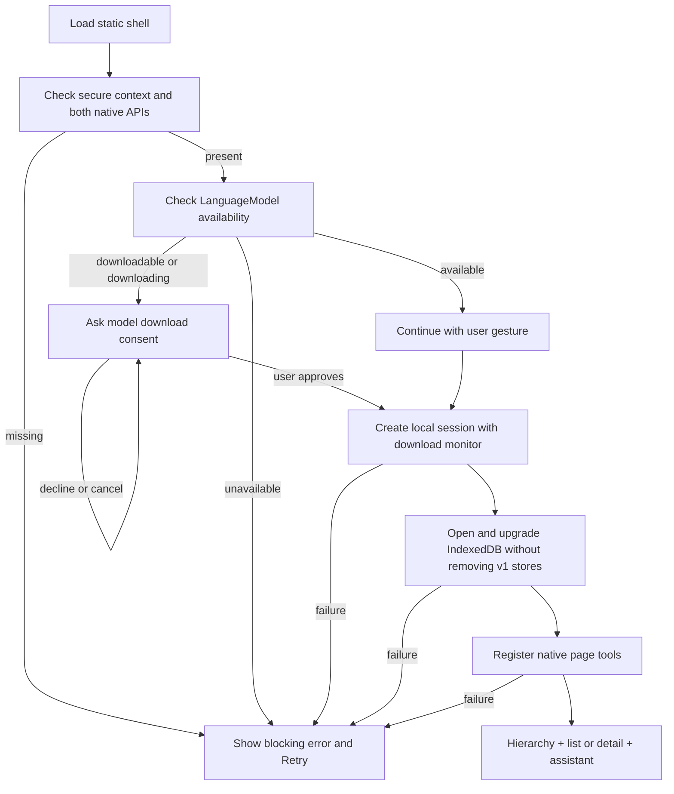

# Workspace flows

These diagrams supplement [app-design.md](app-design.md). Nodes after the startup gate are unavailable until both native APIs, model preparation, persistent storage, and tool registration succeed.



```mermaid
sequenceDiagram
  actor User
  participant UI as Workspace chat
  participant Model as Local Prompt API session
  participant MCP as Native WebMCP
  participant Callback as Registered tool callback
  participant DB as IndexedDB
  User->>UI: Request a task change
  UI->>MCP: getTools()
  MCP-->>UI: Own-page tool descriptors
  alt Native typed proposal mode
    UI->>Model: Context + projected schemas + request
    Model-->>UI: Typed calls with opaque call identities
  else Constrained JSON bridge
    UI->>Model: Tool names/descriptions + bounded context + request
    Model-->>UI: Selected operation name
    UI->>Model: Selected argument schema + request
    Model-->>UI: Constrained argument object
  end
  UI->>UI: Validate envelope and allowlisted call
  UI->>MCP: executeTool(descriptor, arguments)
  MCP->>Callback: Execute registered callback
  Callback->>Callback: Validate arguments and current data
  Callback->>UI: Request first-use permission if needed
  UI->>User: Allow once / this chat / Deny
  User-->>UI: Choice
  UI-->>Callback: App-owned approval result
  opt Delete or another consequential action
    Callback->>UI: Exact target and subtree snapshot
    UI->>User: Allow delete / Cancel
    User-->>Callback: Explicit approval via UI
    Callback->>Callback: Revalidate unchanged target
  end
  Callback->>DB: Atomic mutation
  DB-->>Callback: Transaction complete or error
  Callback-->>MCP: Structured committed result or failure
  MCP-->>UI: Tool result
  UI->>UI: Retain committed receipt; item writes require a fresh message for review controls
  UI->>Model: Delimited tool result data
  Model-->>UI: Final response or next bounded proposal
  UI-->>User: Message + truthful activity status
```

Direct form edits use the same item validator and database transaction but do not need agent first-use permission. Manual deletion still requires its exact subtree confirmation. Denial, cancellation, stale approval, invalid data, and persistence errors all exit without a success claim or automatic mutation retry.
