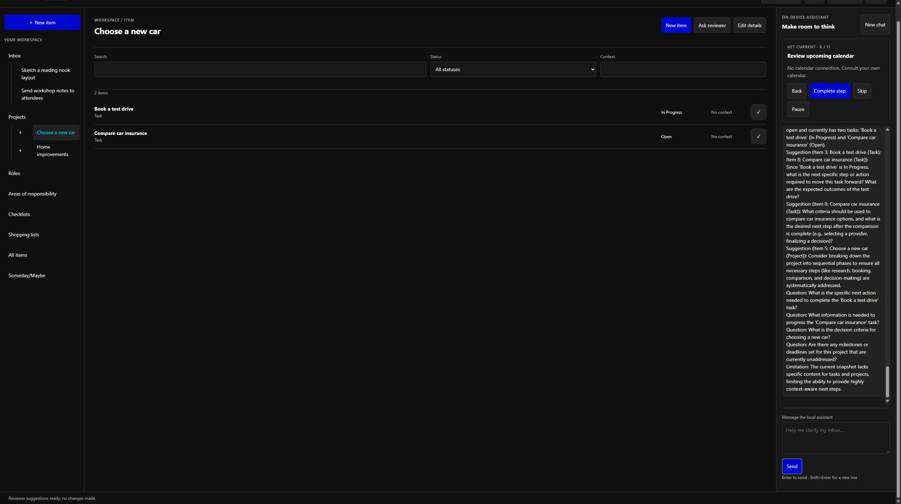
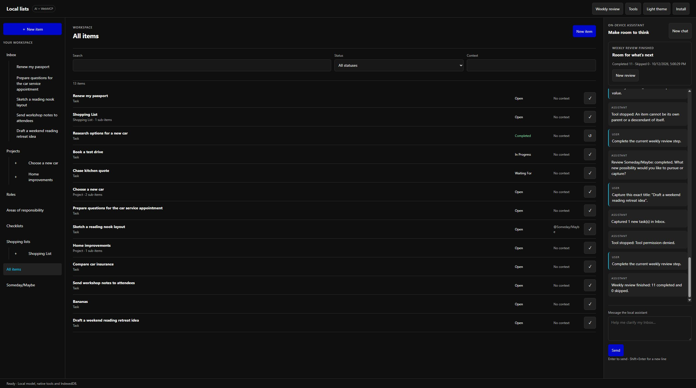

# Harness v2 real Chrome trial

This trial uses the unmodified application, Chrome's real local Prompt API model, and native WebMCP callbacks. It uses an isolated `http://127.0.0.1:8766/` origin and synthetic commitments. No scripted model or tool double is injected into this profile. The reduced user agent reports Chrome 154; model weights and complete flags are not exposed by the page.

The bridge is the default transport. The separate [implementation checks](harness-v2-implementation.md) exercise scripted native proposals and failure cases; they are not evidence of native model competence. The research and plan were committed and pushed before implementation.

## Observations

| Request / action | Observed result |
| --- | --- |
| `Hello. Please give a short greeting.` | V2 returned a greeting with no tool proposal. The cached previous release had proposed a shopping entry; that proposal was denied and saved nothing. |
| `Start my weekly review.` | Proposed `weekly_review start`; Allow once opened step 1. |
| Collected materials; explicitly complete current review step | Fresh Allow once completed step 1 and opened Inbox review (step 2). |
| Inbox is clear; explicitly complete current review step | Fresh Allow once completed step 2 and opened Empty your head (step 3). |
| Mind dump with six quoted exact titles | One approved `capture_tasks` transaction saved six Open Inbox Tasks with the exact supplied titles. |
| Follow-up after that capture | Model proposed an unnecessary Inbox view change with malformed context containing tool syntax. Denied it; all six saved tasks remained. This is a routing failure after successful capture, not a clean autonomous turn. |
| Move insurance comparison and test drive under a new Choose a new car Project | Correct approved atomic operation created the Project and moved both Tasks, preserving Open status. A later proposal failed stale-record validation; the factual saved receipt remained visible. |
| Move kitchen quote under a new Home improvements Project | Model incorrectly selected existing Choose a new car. Denied before any move. This prompted an explicit new-Project parameter guard; retest follows below. |
| `I started Book a test drive. Mark that task In Progress.` | Correct approved status-only operation retained Choose a new car as its parent. A repeated proposal was stopped without another write. |
| Complete Research options for a new car | Correct approved `complete_task` changed only its status. It disappeared from actionable Inbox, leaving three Tasks. A repeated proposal was stopped. |
| Set Chase kitchen quote to Waiting For | Correct approved status-only change saved. A later proposal failed the frozen title-choice check; no later effect occurred. |
| Pause using the review card | Saved step 3 and its completed step 1/2 marks before loading final source. |
| Normal reload and preparation | Restored chat, three actionable Inbox Tasks, Project and statuses, and paused step 3. DevTools cache/service-worker bypass was restored to normal. A read-only debugger hash matched the served app source; debugger was disabled afterward. |
| Quoted new-Project name followed by another sentence | The initially narrow extractor did not constrain this form; the model again proposed the wrong existing destination, which was denied. The extractor was subsequently refined to recognize a quoted name followed by a clear sentence while refusing ambiguous unquoted multi-sentence names. |
| Retry ending with `new Project named "Home improvements".` | Correct approved atomic operation created Home improvements and moved the quote. Factual receipt appeared and the turn finished normally. This exercised the private invocation token through real Chrome's serialized native WebMCP dispatch. |
| Move Renew my passport into existing Choose a new car | Correct approved move; repeated proposal stopped. |
| Normal reload of released source | Debugger script hashes matched app `8064BAFF…` and harness `3D708E04…`; normal caching remained enabled, both Projects and paused step 3 persisted. |
| Move passport from Choose a new car into existing Home improvements | Correct first approved move. Model then proposed moving the five other Tasks into Home improvements. Denied; unrelated Tasks retained their parents. This prompted current-request task-title constraints rather than relying on the permission card alone. |
| Resume weekly review through chat | Fresh approval resumed the saved Empty your head step, retaining completed marks. |
| Explicitly complete Empty your head and then Action Lists in separate messages | Each fresh approval advanced exactly one step; Action Lists showed five incomplete Tasks with their actual statuses. Past-calendar step displayed its no-calendar-connection guidance. |
| Calendar-supplied follow-up `Send workshop notes to attendees` | Approved exact-title capture added one Open Inbox Task, bringing stored records to nine. No message was sent. |
| Follow-up after calendar capture | Model proposed completing unrelated Renew my passport. Denied; it remained Open under Home improvements. Literal names for new captures now also close out existing title workflows with no matching requested record; this guard is retested below. |
| Explicitly finish past-calendar step | Fresh approval advanced only to upcoming calendar (step 6), with no automatic calendar access. |
| Request `Unwanted trial task`, then immediately Stop | Composer returned to idle; no task or tool effect appeared, and existing nine records remained. |
| Select Choose a new car | Its two Tasks displayed Book a test drive In Progress and Compare car insurance Open. |
| `Ask the reviewer to review the selected Project for clear next actions. Make no changes.` | Fresh tool-free local inference returned a validated observation, three suggestions, four questions and a limitation with readable references. It identified the two actual Task statuses, asked for concrete next steps/decision criteria, and noted missing details. No tool activity, item change or review progression occurred. |
| Actual Tools diagnostics | Native WebMCP discovered all sixteen tools; Standard catalog and Chromium compatibility were selected. Typed native Prompt API interfaces were absent, so Test native tool calls and Use native proposals were disabled. The reviewer run recorded one inference, one child, zero dispatches/commits, 24,482.5 ms active work; measured input 345, existing usage 69, context window 9,216. |
| Reload while review was active at step 6 | Domain data and reviewer advice persisted. Review returned paused at step 6, with completed marks intact and no execution replay. |
| UI Resume-generated step guidance | Before the authority fix, the generated `Review: Review upcoming calendar` turn proposed a shopping entry named after the step. Denied; no entry/container appeared. Generated guidance now receives only read-only domain tools and view navigation, while fresh human requests retain ordinary tools. |
| Guidance retest after authority fix | Proposed a read with an invented `weekly-review` context (approved, matching no records), then a proper Inbox read. Stopped the second read at permission. No write proposal/effect was available; routing/filter quality remained imperfect. |
| `Move Renew my passport back to Inbox.` | Model chose status Open, a no-op rather than the requested parent move. Denied and clarified; the route instructions now give a direct Inbox-parent example. |
| Final-source normal reload | App hash `95252979…` and harness `990A8863…` matched the released files. All nine records, paused step 6, and reviewer advice persisted; Unwanted trial task was absent. |
| `Organize Renew my passport by moving it into the Inbox.` | Approved singleton-title move returned the same Open Task from Home improvements to Inbox. Home improvements retained only the Waiting For kitchen quote; car Project retained its two Tasks. |
| Capture upcoming-calendar preparation | Approved exact `Prepare questions for the car service appointment` with empty context saved one Open Inbox Task, bringing records to ten. Existing title workflows were unavailable for this new literal capture. |
| Follow-up capture with omitted context | The same title with omitted rather than empty context initially prompted a redundant no-op approval. Stopped before another dispatch. Capture signatures now normalize that one default; both transport regressions and independent object/serialized callback checks retain one dispatch/receipt and unchanged approved arguments. |
| Resume and explicitly finish upcoming calendar | Separate approved review operations resumed saved step 6 and completed it, opening Waiting For (step 7). |
| Keep the kitchen quote waiting and complete the review step | Model incorrectly proposed completing the quote. Denied; Waiting For persisted. A fresh message asking only to complete the current review step correctly opened Projects (step 8). This remains a model verb/negation limitation, not a passed compound request. |
| `add bananas to shopping list` | Approved `add_shopping_item` atomically created Shopping List and its Bananas child Task. Receipt displayed; repeated proposal stopped without another write. Review stayed at step 8. |
| Move passport to an undecided Project; ask which before changing it | Model attempted an invalid self-parent operation; validation rejected it before permission/dispatch. No record changed. It did not ask the requested question. |
| Explicit clarification question with `Do not call tools` | Model incorrectly proposed a new shopping Task named Renew my passport. Denied before any duplicate/effect. This clarification trial failed; neither prevention nor denial is counted as fulfilled clarification. |
| `Projects reviewed. Complete the current weekly review step.` | Incorrect already-completed research Task proposal was denied. No status changed. |
| Normal reload of the final capture-signature fix | Executed script hashes matched app `95252979…` and harness `A2FAD569…`. Normal cache/service-worker behavior remained enabled, twelve domain records persisted, and review paused at step 8. |
| Resume, then separate `Complete the current weekly review step.` messages | Fresh approvals resumed step 8, completed Projects and then Checklists, opening Someday/Maybe (step 10). Each operation advanced exactly one step; the empty Checklists view displayed zero items. |
| Set Sketch a reading nook layout context, preserving other fields | Model first proposed status Open rather than a context edit; denied. A shorter clarification proposed `update_item` with context `Someday/Maybe`, dropping the requested `@` marker. Operator approved this too early; only context changed, but the Someday view correctly remained empty because it requires `@Someday/Maybe`. A later stale proposal failed, preserving the saved receipt. |
| Explicitly correct the context marker through chat | Model attempted an invalid self-parent move, rejected before dispatch. This correction did not succeed through chat. |
| Operator correction using the labeled item form | Saved exactly `@Someday/Maybe`, retaining the Task title, Open status and Inbox parent. Someday/Maybe then displayed exactly one Task. This was a manual intervention and is not counted as a successful model edit. |
| Explicitly complete Someday review | Fresh approved `weekly_review complete_step` opened Be creative & courageous (step 11), retaining all earlier completed marks. |
| Exact creative title `Draft a weekend reading retreat idea` | Approved `capture_tasks` saved exactly one Open Inbox Task, bringing stored records to thirteen. A follow-up generic update of an existing record was unrequested and denied. The saved capture receipt and Task remained. |
| Complete the final review step through chat | Fresh approved `weekly_review complete_step` finished the review. The main review page listed all eleven steps Completed; the card reported Completed 11, Skipped 0. |
| Final normal reload and preparation | Completed 11, Skipped 0 and the displayed completion timestamp remained unchanged. All items displayed thirteen records with the expected Projects, Shopping List/Bananas, Completed research, In Progress test drive, Waiting For quote, exact corrected Someday context and creative capture. Unwanted trial task and a duplicate passport purchase were absent. No execution resumed or replayed. |

The titles were Compare car insurance, Book a test drive, Renew my passport, Chase kitchen quote, Research options for a new car, and Sketch a reading nook layout.

## Trial result and denominator

The request log contains **41 submitted human chat requests**, including one immediate Stop test, and one additional composer attempt that failed before submission and is excluded. Cached-release greeting and two UI-generated guidance turns are additional observations, not part of that denominator. The table records eleven denied proposals from human-request turns, plus a denied cached-release greeting proposal and a denied generated-guidance proposal. Repeated/stale/invalid proposals and the stopped read/capture are reported separately in the observations. No aggregate model success percentage is claimed: a requested operation can save correctly and still have an incorrect follow-up.

The final eleven-step review finished through approved natural-language chat transitions, with no skipped steps. Domain operations exercised exact six-task capture, two new Projects, moves between existing Projects and back to Inbox, In Progress/Completed/Waiting For changes, shopping container plus purchase, two calendar-supplied captures and a creative capture. A fresh read-only reviewer produced grounded advice. The context change required a manual marker correction; the clarification attempts failed. This was a supervised trial with explicit denials and corrections, not an uninterrupted autonomous run.

The full 23 deterministic runners passed, followed by all ten affected runners after capture-signature normalization and independent final review. These establish host/domain contracts; the actual conversation above measures a different property. Typed native model proposals could not be tried in this browser configuration because the interfaces were absent. The real trial did exercise local Prompt API inference and serialized native WebMCP callbacks through the bridge.

## Remaining model work

Compare routing with and without optional historical turns while retaining the exact current request, unresolved question and saved facts. Evaluate clarification, negation, field preservation and review-versus-Task completion separately using the actual installed model. Add a narrow context-edit workflow with current Task choices and exact supplied context choices only after its design/plan and compound-request behavior are reviewed; do not silently normalize stored context strings to hide incorrect model output. Generic primitives and free values remain outside the targeted Task-title gates, as documented in the implementation evidence. Broad chat grants do not prove that a model proposal matches the current human request.

## Cache update issue

Ordinary reloads initially retained the previous app despite the server serving v2 source. A temporary tab-only DevTools cache/service-worker bypass confirmed the new page. Independent review reproduced old JavaScript being copied into a newly installed shell cache when the HTTP response had `max-age=3600`. The implementation now uses reload cache policy during installation, revalidation for shell/navigation requests and release cache v6; its deployment regression checks a normal reload against a long-lived HTTP cache. Temporary bypass settings must be restored before final persistence checks.

## Evidence boundaries

Permission approval is inspected against the actual proposed effect before each write. Incorrect proposals are denied and recorded. Calendar inputs are supplied synthetic observations; the app has no calendar connector. Receipts and execution journals live only in memory; persistence checks concern domain data, history and paused review state, not replaying execution authority.
