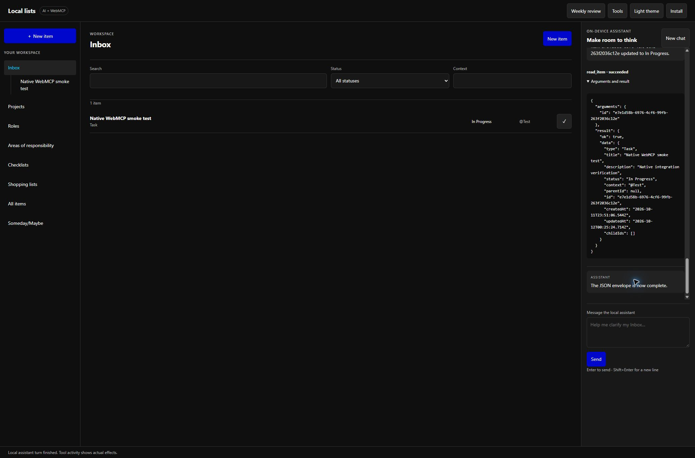
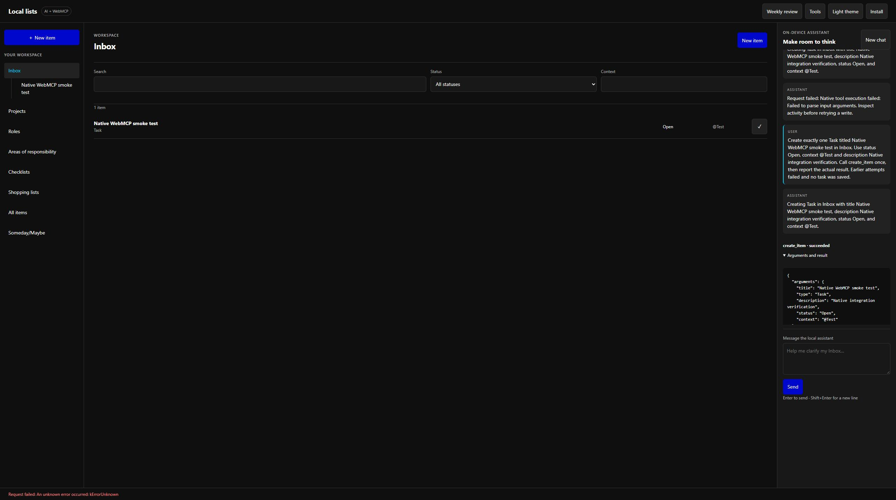

# Native Chrome WebMCP retest

Retested 2026-10-11 in the user's connected Chrome 154 after enabling `chrome://flags/#enable-webmcp-testing`, at `http://127.0.0.1:8765`. This retest used the real `LanguageModel` and `document.modelContext`, not injected API doubles.

## Confirmed native behavior

- The startup gate passed; Chrome reported the local model as available, created a real session, opened IndexedDB v2 and registered all ten native tools.
- Tools diagnostics discovered all ten own-page tools with the expected names and annotations.
- A direct native `list_attributes` execution with JSON-string arguments reached the real permission card. Allow once produced a successful result with the six types, five statuses and attribute rules.
- The real local model proposed `create_item`. After Allow once, the native callback committed exactly one task named **Native WebMCP smoke test**, with status **Open**, context **@Test**, description **Native integration verification**, parent `null` and ID `e7e1d58b-6976-4cf6-99fb-263f2036c12e`. The list and activity showed the committed item and `ok:true` result.
- The real local model also proposed `read_item`; after Allow once, the native read callback succeeded. An unnecessary repeated read was denied without changing data.
- After the user closed the test tab and reconnected Chrome, the task and conversation survived reopening the app. The native read again returned status **Open**. A normal constrained chat response also returned `{message:"Hello",tool:null}`.
- With the final context cleanup, the real model proposed `update_item` with `{id,patch:{status:"In Progress"}}`. The native bridge received serialized JSON arguments and reached the normal permission card. Allow once committed the update; the list showed **In Progress @Test** and activity showed **update_item · succeeded**.

## Compatibility findings and fixes

Chrome 154 discovery returns `inputSchema` as a JSON string, and `executeTool` requires JSON-string input arguments. Object arguments failed before callback execution with **Failed to parse input arguments**. The app now parses serialized schemas for model context and serializes arguments when the discovered descriptor uses a serialized schema; newer object descriptors retain object arguments. It selects the format before dispatch and does not retry a dispatched write. [Current Chrome imperative API documentation](https://developer.chrome.com/docs/ai/webmcp/imperative-api) describes the newer object contract and notes the JSON-string deprecation from Chrome 155.

The first model continuation after the committed creation failed with **kErrorUnknown**. The saved task remained durable, and the app did not retry the write. A subsequent native read continuation ran but proposed an unnecessary repeat. Instrumented real model usage rose from 104 to 2039 to 4162 tokens in a 9216-token window while the app resent its complete catalog/history on each prompt. These observations do not establish the cause of the generic backend error. The app now sends a small verified-result continuation without repeating the original request, catalog or transcript; it explicitly asks the model to finish fulfilled requests.

Later native edit requests echoed a historical **Tool stopped: Tool permission denied.** message without dispatching a tool. Wording clarification alone and moving the request to a separate field did not resolve this behavior. The final implementation sends the current request as its own Prompt API user message, scopes stopping/retry instructions to the current turn, and omits only assistant diagnostic strings beginning `Tool stopped:` or `Request failed:` from the bounded model transcript. Full stored/UI history remains intact, as do ordinary user and assistant conversation, current verified results, callback validation and tool permission cards. Historical diagnostics remain visible to the user but are not automatically supplied when asking the model about an old error. [Chrome's Prompt API documentation](https://developer.chrome.com/docs/ai/prompt-api) documents role-based prompt inputs. The final native edit retest is recorded below.

## Automated regression evidence

Passed after the compatibility changes:

```sh
node tests/self-check.mjs
node tests/native-contract.cjs
node tests/browser-review.cjs
```

The focused contract test uses isolated doubles for both serialized and object native contracts, real DOM and IndexedDB, a denied turn followed by one approved creation, a separate current user message, a bounded result continuation and reload persistence. It also confirms that the denied diagnostic remains visible after reload while later model context omits it and retains ordinary dialogue. It complements the native evidence above; it does not replace native model testing.

## Final native result and limits

After reconnecting Chrome, the persisted task and conversation were confirmed on reopening. The final native update succeeded once, followed by an approved native `read_item` verification. Its real result retained the title, description, context, parent and creation timestamp while showing status **In Progress** and updated timestamp `2026-10-12T00:25:24.714Z`. The model reported the updated status, then finished with a null tool response; the composer became enabled and the footer reported the turn finished. No duplicate write was dispatched. Temporary logging wrappers were removed.

The native smoke flow now passes: startup, ten-tool discovery, permission cards, creation, read, update, model continuation and task/chat persistence. This does not certify every native tool, all eleven weekly-review steps with the real model, or native PWA install acceptance. Those broader application workflows have separate automated evidence in the initial review. Chrome's earlier generic model backend error remains an observed limitation; its cause was not established. The labeled test task was retained in the user's loopback-origin workspace; no user task or stored conversation was deleted.

The independent reviewer inspected all final compatibility/context changes and independently reran the focused regression successfully. No substantive code finding remains. A direct mutating debugging probe was rejected by automatic approval review and did not run; the completed edit instead used the normal model proposal and permission card.



Earlier creation evidence, including the subsequent backend error:


