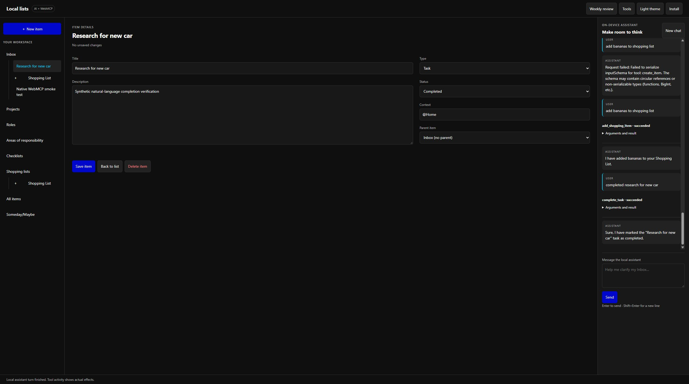
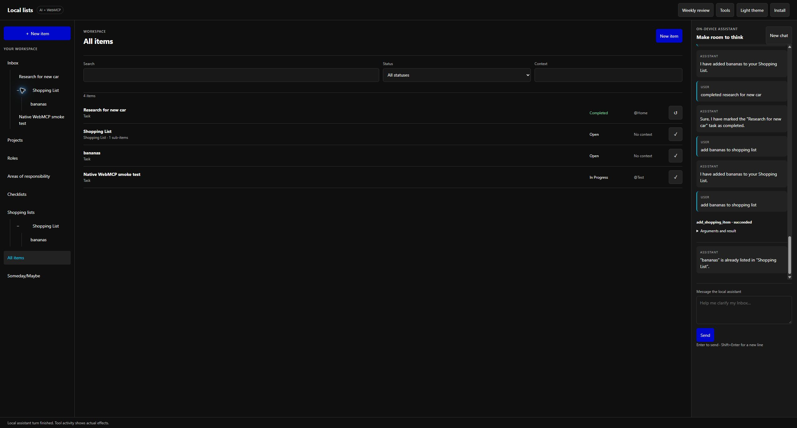

# Natural-language Chrome review

Reviewed on 2026-10-11 using the real local Chrome model and native WebMCP at `http://127.0.0.1:8765`.

## Baseline findings

The exact request **add bananas to shopping list** proposed creating a Shopping List named **bananas**, rather than an entry beneath a list. The message simultaneously claimed it could not add items and asked the user to use a tool. This proposal was denied; no data changed.

After the first routing improvement, the real model proposed `null` for a text argument. Application validation stopped it before dispatch. The bridge's output grammar previously constrained only a generic arguments object; it now constrains each tool's actual schema. Optional unused fields may be omitted, and text fields are explicitly described as strings.

Chrome rejected the complete argument grammar with `NotSupportedError`. Read-only model probes confirmed that a projection excluding `oneOf`, `not` and `minProperties` was accepted, including nullable type arrays. The model decoder now uses that projection, while the full application/native WebMCP schemas remain authoritative.

## Native findings and fixes

After enabling the separate `chrome://flags/#prompt-api-tool-use` flag and reconnecting Chrome, all three typed Prompt API tool classes were exposed. Chrome completed its additional model preparation, and Tools & diagnostics selected the native tool loop.

The primitive-only retest still invented parent ID `-1` for bananas; validation blocked it. The completion phrase was incorrectly used verbatim as a search and repeated an empty lookup; replay protection stopped it. These failures motivated application-owned `add_shopping_item` and `complete_task` workflows, with readable enum choices and internal ID resolution. No failed proposal was accepted as a successful natural-language test.

The initial mixed null/string reference enum failed native tool-schema serialization. Separating nullable choices into `anyOf` null and string-enum alternatives allowed real native session creation. The native reply parser also accepts bounded plain-string final text for compatibility.

## Verification

The harness and natural-workflow regressions, existing browser workflows, independent interface checks, service-worker checks and shared logic checks passed. The workflow runner passed 19 checks using production IndexedDB transactions, including rollback after a failed second write. A separate continuation regression verifies that inserting a same-title record before an existing record never retargets the existing model choice; it passes on the bridge and both native call-ID contracts. The independent reviewer reviewed correlation, approval, cancellation, result projection, stable choices, atomic storage and replay behavior. These automated browser tests use isolated model/tool doubles except for service-worker behavior and the native startup-gate check.

The following exact phrases were entered through the normal chat UI, without tool names or item IDs, using the real Chrome model and native WebMCP:

| Request | Observed result |
| --- | --- |
| **add bananas to shopping list** | Model proposed `add_shopping_item` with title `bananas`. The normal permission card showed creation of Shopping List and its child Task. Allow once committed both; actual tool activity succeeded and the model answered “I have added bananas to your Shopping List.” |
| **completed research for new car** | Model selected the existing title `Research for new car` using `complete_task`. Permission showed Open → Completed, status only. Actual activity succeeded; the model confirmed completion. The detail form retained its description, `@Home` context and Inbox parent. |

The Research task was seeded through the ordinary New item form with description `Synthetic natural-language completion verification`. Reload preserved the task's Completed status and the Shopping List/bananas hierarchy. A clean-detail refresh issue found during testing was fixed; the focused workflow regression now checks visible status updates while dirty drafts retain conflict protection.

Repeating **add bananas to shopping list** after reload selected `listTitle: Shopping List`. The approval card showed an already-listed purchase with `changes: []`; actual callback outcome was a no-op. The model's acknowledgement still said it had added bananas again. Workflow-only final confirmations now use the verified receipt, and a regression deliberately supplies that incorrect model wording to check it is replaced. The reviewer also reproduced invented success after a denied workflow; a regression now checks that false prose is withheld both before its permission card and after Deny, with no denied item saved. Clarification feedback stops any proposed follow-up write until the user answers.

The final native retest, after reloading the receipt fix, again returned an already-listed no-op. The chat displayed the verified confirmation **“bananas” is already listed in “Shopping List”.** All items showed exactly four records: the earlier smoke-test Task, Research for new car (Completed), Shopping List (one child), and bananas (Task, Open). Expanding the hierarchy showed bananas beneath that list. No duplicate was created.

Independent review finished with no substantive finding open. Large global enum catalogs remain a documented prototype capacity limit; UI filtering currently does not reduce model catalog size. These real-model examples establish the two requested workflows on this Chrome setup, not universal language understanding or success on every browser/model version.
