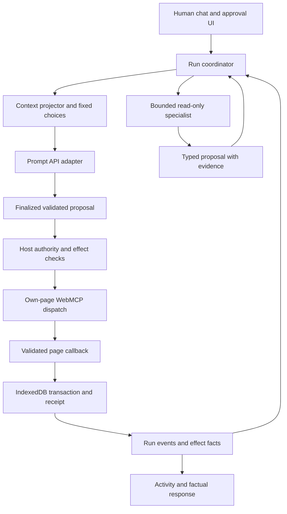

# A browser-only agent harness derived from the research

Research date: **2026-10-12**. This is a proposed architecture for a later design and implementation pass, not a description of newly implemented behavior. Read the [research index](README.md) for source revisions and evidence boundaries. The prototype continues to require native Prompt API and WebMCP, local IndexedDB, static files, and no build or backend, as specified in [INTENT.md](../../INTENT.md) and [AGENTS.md](../../AGENTS.md).

## The architectural decision

Keep one trusted application host between human intent, model proposals, and page effects. Pi contributes useful lifecycle, context-projection, queue, and session patterns. Pi Subagents contributes specialist contracts, supervision, and capability ceilings. Neither supplies browser readiness, authorization, transaction atomicity, or reliable background execution for this app. The adaptation should use small browser-native modules rather than importing their Node runtimes. See [Pi's actual loop](pi-agent-loop.md) and [Pi Subagents](pi-subagents.md) for the source trace and differences.

The host should own these boundaries:

| Boundary | Authoritative owner | Proposed responsibility |
| --- | --- | --- |
| Human request | Chat UI and run coordinator | Record a new human instruction separately from stored conversation, child reports, and tool output |
| Application truth | IndexedDB and domain operations | Items, relationships, review progress, validated transactions, and committed outcomes |
| Execution authority | Existing page callbacks plus host policy | Validate, show concrete permission/effect UI, recheck state, commit, and return a receipt |
| Model interaction | Prompt API transport adapters | Native calls or constrained JSON proposals; normalize their lifecycle without conflating protocols |
| Context | Context projector | Role instructions, current relevant facts, frozen readable choices, bounded completed turns |
| Agent scheduling | Run coordinator and specialist scheduler | Own identities, budgets, cancellation, queues, and terminal decisions |
| Presentation | Event reducer | Provisional text, approval cards, activity, and factual completion reports |

WebMCP declarations describe available capabilities; they do not enforce argument schemas or the application's authority policy. Prompt API grammar controls output structure; it does not establish intent or permission. Preserve both callback validation and approval even when a model-facing enum is correct. [Imperative API implementation evidence](webmcp-imperative-api.md), [structured output](chrome-structured-output.md), [tool design and security](webmcp-effective-tools.md).



The diagram is conceptual. A child report is input to the root's reasoning, never direct input to a write callback. The host, not a model-generated actor field, supplies trusted run and agent identities.

## Run and event contracts

One logical run starts with a fresh human request and may contain several model responses and tool-result rounds. The bridge's route, argument, and response prompts are inference stages within that run. A child job is a supervised run with a narrower purpose, not a second human request. Continue is an explicit user action that preserves prior committed-effect facts and the current review boundary.

Introduce a small typed lifecycle before adding specialists. Suggested event names below are **original application design**, not Chrome or Pi API names:

| Event | Fact established | Fact it does not establish |
| --- | --- | --- |
| `run-started` | Human request and host identity recorded | Permission for arbitrary tools |
| `inference-started` / `inference-finished` | One actual model request started/finalized | A requested effect happened |
| `proposal-finalized` | Complete proposal accepted by parser/validator | Approval or commit |
| `approval-requested` / `approval-decided` | Concrete effect presented and decision recorded | Current target still matches the approved snapshot |
| `dispatch-started` | A call crossed the execution boundary | Callback succeeded |
| `effect-committed` | Domain transaction completed with exact result | All sibling calls or final narration succeeded |
| `call-settled` | Success, denial, cancellation, stale target, failure, or uncertain outcome recorded | Automatic retry eligibility |
| `child-settled` | Bounded specialist report or failure accepted | New authority from the child's prose |
| `run-settled` | Owned sessions, approvals, bookkeeping, and accepted event work finished | A closed run may accept late callbacks |

Events need stable host-generated run/agent/call identity, parent identity where relevant, ordered sequence, timestamps, and structured outcomes. Native `callId` remains an opaque protocol identity, separate from an item ID and a write signature. A JSON bridge can use internal host call identities without presenting them as browser-native IDs. Keep every pending native call accounted for once, including skipped siblings after a terminal result. Chromium's experimental executor does not fully enforce response counts/IDs; the host must. [Native tool-use evidence](chrome-prompt-api-tool-use.md).

Store only what recovery and diagnosis need, with explicit retention and bounded model projection. A UI transcript is insufficient as an execution ledger. An event journal also does not by itself create exactly-once effects: any future durable operation receipt must be written atomically with its domain mutation, with an explicit operation identity and recovery contract. Otherwise a crash between the data commit and event write leaves an uncertain outcome. Never infer a missing receipt means no write occurred. [Pi persistence boundary](pi-agent-loop.md), [current transaction and effect rules](../harness.md).

## The execution loop

The following pseudocode describes host responsibilities. It is not executable code or a proposed new browser API:

```text
accept fresh human request; create host run identity
record current review boundary and committed-operation facts
while run is current and within shared budget:
    project relevant state, completed history, role, and fixed choices
    await one finalized model response through selected adapter
    reject malformed, incomplete, duplicate, or out-of-scope calls
    if no calls: settle factual reply; finish
    for each accepted call in source order:
        stop dispatch if a terminal result or review boundary was reached
        resolve original readable choice; rediscover own-page descriptor
        check current-request policy, args, capability, and concrete effect
        await concrete permission when required
        callback rechecks state and commits in its domain transaction
        retain actual result even if later inference or reporting fails
        give exactly correlated success/error/skipped feedback
    end on denial, cancellation, stale state, failure, clarification,
        review transition, or an explicit exhausted budget
destroy owned model sessions; close approvals; reject late events
```

Keep serial page effects and permission prompts. Pi's default parallel execution and its `terminate` hint do not implement this app's stop-on-first-terminal-result policy. One child's report, a result hook, or streamed text cannot widen a validated/approved plan. Changing arguments after approval requires full revalidation and a new decision for the changed effect. [Pi scheduling and hook evidence](pi-agent-loop.md).

A committed item operation does not authorize advancing a weekly-review step. Preserve the existing fresh-message boundary. A final non-executing explanation may report receipts after a terminal outcome; it must not reopen dispatch. The UI should distinguish a valid no-tool conversational answer from an unsupported claim that a task was saved. See [current review evidence](../weekly-review.md) and [effective-tool evaluation](webmcp-effective-tools.md).

## Transport selection and readiness

Retain the constrained JSON bridge as the validated baseline. Native Prompt API tool use is a separately measured experiment using Chrome-local inference and the same native WebMCP execution boundary. The native flag changes tool exposure, conversation backend, and a foundation-model selection parameter in the pinned source, so do not assume both comparisons use identical model weights. Record available model-selection evidence and configuration differences. The flag is not a WebMCP flag or proof that the selected model can call tools. [Flag and source analysis](chrome-prompt-api-tool-use.md).

Check constructor/method exposure, option-specific availability, creation, and a harmless native tool-call canary as separate observations. Record actual Chrome version/channel, relevant flags, options and schemas, and model diagnostics where available. Availability has a source-level tool-preflight gap, so a text-ready status cannot substitute for canary evidence. Keep base-session creation failure distinct from a failure while generating a native proposal.

Fallback can be considered only before dispatch and before unresolved pending calls/effects exist. After an effect boundary, changing transports and replaying the request risks duplicate work. A bridge fallback must still pass the native WebMCP gate; a polyfill or fixture cannot demonstrate the maintainer's two required APIs. [Prompt API](chrome-prompt-api.md), [WebMCP overview](webmcp-overview.md).

## Context and readable enum choices

Separate canonical application facts, canonical run events, projected model context, and temporary session memory. Refresh tool discovery at safe inference boundaries, but do not silently retarget a turn's frozen item aliases. A record changing during permission or inference should make the old proposal stale, not make its alias refer to a different record. A model never needs storage IDs to choose a named task; the host can resolve the enum reference against its private snapshot. This preserves the user's earlier design direction. [Session management](chrome-session-management.md), [structured choices](chrome-structured-output.md), [tool catalog guidance](webmcp-effective-tools.md).

Give each stage only the relevant catalog and facts. Keep useful parameter descriptions rather than recursively deleting every `description` key. Domain bounds and exact title choices are distinct from a hard character cap on natural-language replies. Preserve omitted-field meanings, negation, title identity, parent choices, and review state. Exposed schema structure is not validation proof, including when declarative forms generate enums.

Measure session context where supported and record actual usage/window, reserving room for output and tool results. Character count and hidden schema estimates are approximations; the pinned implementation does not account for every constraint path as the draft describes. Do not rely on overflow as a preventative warning: guides describe eviction while the draft has a rejecting path. Record actual-build behavior before choosing thresholds. [Compaction](chrome-session-compacting.md), [structured-output accounting](chrome-structured-output.md).

Compact only at a closed boundary with no pending calls, approval, continuation, or uncertain effect. Keep canonical data and full evidence outside the summary. Preserve exact restrictions, effect facts, unresolved ambiguity, and complete tool-call/result pairs; rebuild current choices after compaction. An optional Summarizer result can aid continuity, not grant permission or replace receipts. If compaction fails, use a smaller deterministic projection or ask for clarification; never replay history. [Compaction research](chrome-session-compacting.md).

## First specialist and supervision contract

Start with one explicit role, such as an Inbox clarifier or Project next-action reviewer. Its job is to inspect a bounded snapshot and propose questions or next actions. Host scheduling may follow a configured review flow or a direct human request; complexity and model preference alone should not grant autonomous delegation. Pi Subagents' capability and provenance checks are useful patterns, while its runtime, defaults, and background runner are not suitable browser defaults. [Pi Subagents study](pi-subagents.md).

Suggested first contract:

- Host assigns child identity, parent run, role, scope, snapshot revision, and cancellation lineage.
- Child has read-only or snapshot-only context, an explicit tool allowlist, and no mutation, approval, review-control, arbitrary-script, network, or delegation capability.
- Child returns a bounded typed object: observations with evidence references, proposed next actions, unresolved questions, and limitations. This is a proposal, never a receipt.
- Root validates the report and freshness, then presents useful questions or proposes a separately approved operation through its existing gate.
- A cancelled, failed, or superseded child cannot resume the root or emit accepted late events.

Default to **one active local inference**, one specialist at a time, and no nested children in the first version. All route/argument/reply/canary/child requests consume a shared budget. Separately cap tool dispatches, total inference stages, elapsed time, context, output/report sizes, and live sessions. Add concurrency or nesting only after measured hardware and workflow evidence. These defaults are recommendations, not existing Chrome limits.

Clone or fresh-session choice concerns context, not security isolation. A clone inherits history; a fresh session still has access to whichever tools the host gives it. WebMCP callbacks do not establish an authenticated logical specialist identity simply because the model supplies an `agent` argument. Do not transfer the root's chat grant into child tool access. Any eventual child write capability needs an independently reviewed identity/dispatch design, rather than a smaller prompt alone.

## Suspension, cancellation, and recovery

Use linked AbortControllers for root inference, child inference, and active page-tool execution, while maintaining distinct registration and invocation lifetimes. Unregistering a WebMCP tool does not cancel an already running callback. Destroy unused sessions in finally paths and keep a generation check to reject stale callbacks. Stop cancels future work and pending permission; it does not undo a committed transaction. [Imperative lifecycle](webmcp-imperative-api.md), [Prompt session lifecycle](chrome-session-management.md).

On reload or tab loss, restore records and review position, display committed or uncertain effects, and require fresh human input before action. Do not persist/revive approval grants, native session objects, or in-flight execution plans as automatically runnable jobs. The PWA service worker can serve static assets; the researched interfaces do not establish local model inference or persistent agent execution in workers. Pi's detached runner is not a browser background-work guarantee. [WebMCP limits](webmcp-overview.md), [Pi child execution modes](pi-subagents.md).

## What must be proven before implementation grows

Use the subsequent [next actions](../../nextactions.md) to sequence design, plan, implementation, and review. At minimum, demonstrate actual native contracts for the target build; preserve approval/stale-state/atomicity/cancellation behavior; prove no-tool narration cannot fake an effect; measure context and total inference cost; and test a read-only specialist without widening the root's authority. Fixtures prove deterministic host logic, not local-model task understanding. Demo source, echo-model tests, dry-run evaluators, and polyfills each need their own evidence label.

This architecture leaves optional APIs, streaming, declarative forms, nested specialists, and model-based compaction behind measured need. The intended product remains a small local list manager and guided weekly review, with a host that makes every effect concrete and inspectable.
