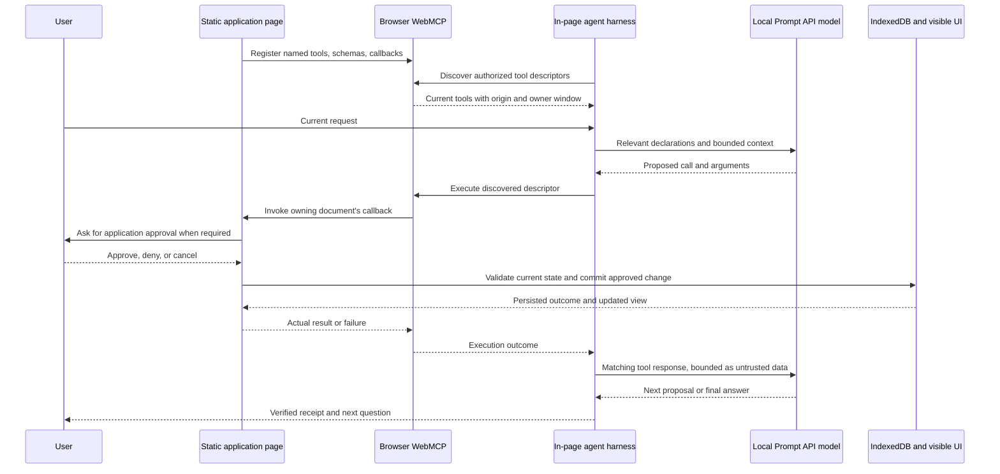

# WebMCP overview: page tools, browser mediation, and the local agent boundary

Research date: **2026-10-12**. Primary requested page: [Chrome WebMCP overview](https://developer.chrome.com/docs/ai/webmcp), published 2026-05-18 and updated **2026-10-07**. This is research and a proposed validation plan; it changes no application behavior. The app remains static, browser-only, and free of runtime dependencies and build requirements under [AGENTS.md](../../AGENTS.md), [INTENT.md](../../INTENT.md), and [DESIGN.md](../../DESIGN.md).

Companion research: [Imperative API](webmcp-imperative-api.md), [Declarative API](webmcp-declarative-api.md), [Effective tools](webmcp-effective-tools.md), and [WebMCP tools repository](webmcp-tools.md). Prompt/model details belong in [Prompt API](chrome-prompt-api.md) and [Prompt API tool use](chrome-prompt-api-tool-use.md).

## Evidence and version discipline

Chrome documents an experimental proposed standard, an origin trial from Chrome 149, and local testing through `chrome://flags/#enable-webmcp-testing` followed by relaunch. It offers imperative JavaScript and annotated-form APIs. Limitations include visit-dependent discovery, complex-interface state work, and a human-focused browser workflow. Feature-test the actual browser. [Chrome overview](https://developer.chrome.com/docs/ai/webmcp).

The research uses the following immutable primary evidence:

| Source | Pin and evidence role |
| --- | --- |
| WebMCP proposal repository | [`d0e4e0e0f039358cc9d93f90074116622bfebd53`](https://github.com/webmachinelearning/webmcp/tree/d0e4e0e0f039358cc9d93f90074116622bfebd53); explainer, Community Group draft, implementation status, security self-review, and separate exploratory documents |
| Chromium implementation | [`578db53b7ff6a3eaa28e561e25cb6b1e4878da3a`](https://github.com/chromium/chromium/tree/578db53b7ff6a3eaa28e561e25cb6b1e4878da3a/third_party/blink/renderer/core/script_tools); binding and execution evidence, not proof of the installed browser's behavior |
| GoogleChromeLabs tools | [`04732fb849ab5eff0cd8d13c6f153e26ebb7bcad`](https://github.com/GoogleChromeLabs/webmcp-tools/tree/04732fb849ab5eff0cd8d13c6f153e26ebb7bcad); analyzed in the companion tools report |
| Historical extension | [`6f627070736a8ca451d5acb02b70f63a1e072f92`](https://github.com/GoogleChromeLabs/webmcp-extension/tree/6f627070736a8ca451d5acb02b70f63a1e072f92); existing repository research in [harness.md](../harness.md), not a current compatibility promise |

Read the official guide as Chrome documentation, `index.bs` as a **CG-DRAFT**, and supplementary explainers as proposals. The pinned explainer describes declarative forms as separate exploration outside its specification; Chrome already documents experimental declarative support. Those statements concern different scopes and do not cancel each other. [Draft status](https://github.com/webmachinelearning/webmcp/blob/d0e4e0e0f039358cc9d93f90074116622bfebd53/index.bs#L1-L20), [explainer, lines 315–321](https://github.com/webmachinelearning/webmcp/blob/d0e4e0e0f039358cc9d93f90074116622bfebd53/README.md#L315-L321), [Chrome Declarative API](https://developer.chrome.com/docs/ai/webmcp/declarative-api).

Two source-drift traps need explicit qualification. The older comparison page says interaction is exclusively with a browser's built-in agent, while the current imperative guide documents in-page agents and cross-origin discovery. The security page mentions `requestUserInteraction()`, while the pinned Chromium callback-options dictionary contains only `signal`. Use the current inspected surface and an actual browser check before adopting an older example or a future proposal. [Comparison page](https://developer.chrome.com/docs/ai/webmcp/compare-mcp), [current discovery documentation](https://developer.chrome.com/docs/ai/webmcp/imperative-api#discover_tools), [security guidance](https://developer.chrome.com/docs/ai/webmcp/secure-tools#next_steps), [Chromium callback options, lines 27–35](https://github.com/chromium/chromium/blob/578db53b7ff6a3eaa28e561e25cb6b1e4878da3a/third_party/blink/renderer/core/script_tools/model_context_tool.idl#L27-L35).

## When WebMCP fits

Use WebMCP when a user and agent need to work in the same live interface and an application can expose a meaningful action through its own code. Good candidates are structured data entry, complicated filters, application state changes, and interactions that otherwise require the agent to infer several buttons or fields. The user-journey guide illustrates shopping through search/wishlist tools, work timesheet forms, warranty-claim assistance, and property/travel filtering. The recurring pattern is an explicit goal, contextual inputs, observable application changes, and an opportunity for human review. The examples are illustrative journeys, not guarantees of agent competence or automatically available browser capabilities. [How WebMCP fits in user journeys](https://developer.chrome.com/docs/ai/webmcp/use-cases).

**Repository inference:** the list manager is a suitable experiment because its durable state and user-visible hierarchy already have named operations. Creating a task, moving it beneath a project, resolving an ambiguous title, and advancing a weekly-review step each have application semantics that a screenshot alone does not fully express. The most useful success criterion is a correct persisted change and accurate visible receipt, followed by the right next question. A fluent model answer alone is insufficient.

**Repository inference:** favor the imperative path for the current storage transactions, batch workflows, dirty-detail handling, and review transitions. A declarative form experiment could later compare assistance filling the existing detail editor, but would need to preserve explicit Save, validation, stale-write checks, and dirty-draft behavior. Declarative registration is not a reason to rewrite the whole application as forms, add a framework, or introduce a backend.

## Architecture and complete tool lifecycle

Chrome's agents landing page describes three separate stages: the site declares tools; the browser makes their contracts available to a WebMCP-aware agent with page context; the agent supplies structured arguments and the site's code performs the operation. Browser mediation is the connection between the page and an agent host. It does not supply the model, the user's goal, the application transaction, or every permission decision. [WebMCP and AI agents, “How WebMCP works”](https://developer.chrome.com/docs/ai/agents#how_webmcp_works).

The following original diagram maps those responsibilities onto this repository. It expresses an intended experiment architecture, not an external transport implementation.

1. **Site registration:** page-owned code supplies metadata and a callback; registration belongs to a document. HTML annotations offer a second experimental path for form-based tools.
2. **Browser exposure:** the browser records registrations and applies its feature, context, origin, and policy boundaries. Availability in this page's local catalog does not imply discoverability from every tab, frame, extension, or agent.
3. **Agent-host discovery:** an in-page host uses `document.modelContext.getTools()`; browser-integrated hosts have their own internal path. The host must retain tool identity as well as a human-readable name.
4. **Model proposal:** the host supplies tools and relevant state to its chosen model. The model predicts an operation; WebMCP does not infer that operation itself.
5. **Dispatch:** the host invokes the discovered descriptor through `executeTool`; the browser routes to the tool's owning document. A model declaration containing the same name is not itself a page execution.
6. **Application work:** the callback validates, requests any application consent, resolves current targets, performs the transaction, and updates the UI.
7. **Response and continuation:** the host records the actual outcome, feeds it back to the model, refreshes relevant state, and decides whether another call is permitted.

The registration/discovery/execution/response split follows the pinned explainer. The additional model, approval, persistence, and receipt stages describe this repository's harness responsibilities. [Explainer lifecycle, lines 308–313](https://github.com/webmachinelearning/webmcp/blob/d0e4e0e0f039358cc9d93f90074116622bfebd53/README.md#L308-L313), [draft distinction between in-page and browser agents, lines 687–692](https://github.com/webmachinelearning/webmcp/blob/d0e4e0e0f039358cc9d93f90074116622bfebd53/index.bs#L687-L692), [app registration/discovery](../../app.js), [model loop](../../harness.js).

## WebMCP, MCP, Prompt API, and actuation

| Surface | What it contributes | What this prototype still owns |
| --- | --- | --- |
| Native WebMCP | Page tools, browser-mediated discovery and invocation, document/origin identity | Tool meaning, validation, permission UI, durable transactions, results |
| MCP server | A protocol connection to external tool providers, independent of this page's own callback registration | Not required by the browser-only product intent |
| Prompt API | On-device inference and model sessions; optional typed tool proposals on a separate experimental surface | Tool declarations, executing predicted calls, matching actual responses, conversation limits |
| DOM/screenshot actuation | Observing and operating a human interface through clicks, typing, and navigation | Not needed to execute the app's registered tools; still potentially useful to other browser agents |

WebMCP is MCP-inspired rather than a browser implementation of the complete MCP protocol. Chrome's comparison guide distinguishes browser-local UI context from externally hosted integrations and notes that WebMCP omits MCP concepts such as resources. The two may coexist in other products; that is not a requirement to create an MCP server here. [When to use WebMCP and MCP](https://developer.chrome.com/docs/ai/webmcp/compare-mcp).

The pinned explainer says registered tools can coexist with ordinary page actuation; an agent can still use browser automation when the provided tools cannot accomplish a task. Registration therefore does not eliminate all automation or prevent an extension with sufficient page access from running other JavaScript. [Explainer, lines 87–91](https://github.com/webmachinelearning/webmcp/blob/d0e4e0e0f039358cc9d93f90074116622bfebd53/README.md#L87-L91), [extension access caveat](https://developer.chrome.com/docs/agents/security#build_safer_agents).

**Repository finding:** the constrained JSON proposal path is still a local model-to-tool harness over native WebMCP. It is not a WebMCP polyfill. Both typed and JSON paths discover native tools and dispatch through `document.modelContext.executeTool()`. The typed Prompt API surface is optional; the required WebMCP surface is not. The app's compatibility choice cannot be reported as a change from native tools to an application-owned tool registry. [app.js](../../app.js), [harness behavior](../harness.md).

## Imperative and declarative boundaries

The current imperative API uses **`document.modelContext`**. Native Chromium bindings expose `ModelContext` on `Window` in secure contexts under the `WebMCP` runtime feature, and extend `Document` with a same-object `modelContext` property. This snapshot does not justify using an obsolete navigator interface or treating a service worker as the registration owner. `getTools()` supplies descriptors; `executeTool()` accepts the descriptor and an object argument in this version. [Chromium interface, lines 65–80](https://github.com/chromium/chromium/blob/578db53b7ff6a3eaa28e561e25cb6b1e4878da3a/third_party/blink/renderer/core/script_tools/model_context.idl#L65-L80), [Document supplement](https://github.com/chromium/chromium/blob/578db53b7ff6a3eaa28e561e25cb6b1e4878da3a/third_party/blink/renderer/core/script_tools/model_context_supplement.idl#L7-L11).

Chrome's declarative guide describes `toolname` and `tooldescription` on a standard form, optional parameter descriptions, visible field filling, manual submission by default, and `toolautosubmit` as an explicit choice. A submit handler can prevent default navigation and return a promise through `respondWith`; `agentInvoked` identifies agent-triggered submission. These are form-specific semantics, not a universal transaction or consent facility. [Chrome Declarative API](https://developer.chrome.com/docs/ai/webmcp/declarative-api).

**Repository finding:** the app presently registers sixteen imperative tools and has no declarative tool attributes. A future comparison must check the browser-generated form schema and user-visible behavior, rather than assuming it matches the handwritten imperative schema. Two registrations for one action could create overlap or duplicate names; a controlled experiment should define one active contract per operation and explicitly compare results. Detailed form events, eligibility, submission behavior, and version changes belong in the declarative companion report.

## Getting started, availability, and frame scope

The origin trial is an experimental, time-limited distribution mechanism, not an installation dependency. Chrome's announcement identifies Chrome 149 as its starting point. The pinned implementation-status document reports an origin trial and local testing flag; it is a browser/agent status snapshot rather than a guarantee of broad interoperability. [Origin-trial announcement](https://developer.chrome.com/blog/ai-webmcp-origin-trial), [pinned implementation status](https://github.com/webmachinelearning/webmcp/blob/d0e4e0e0f039358cc9d93f90074116622bfebd53/implementation-status.md#L17-L25).

For an origin-trial experiment, register the intended origin, supply a valid token on each participating document through a meta tag or HTTP header, and check expiry and context matching. Chrome ignores invalid or expired tokens. Frame access and feature policy are additional checks; a trial token does not imply cross-origin authorization. The generic trial guide has specific rules for embedded contexts, extension pages, and content scripts. This research did not register a trial, install an extension, modify browser flags, or verify the trial's exact end date. [Get started with origin trials](https://developer.chrome.com/docs/web-platform/origin-trials).

**Proposed local setup record:** serve the unchanged static folder on localhost or HTTPS; record Chrome version/channel and launch mode; manually confirm the WebMCP testing flag or applicable trial is enabled; then record the actual method shapes and successful registration/discovery. For optional native model tool proposals, record the separate `chrome://flags/#prompt-api-tool-use` flag and typed classes. A flag's display name, a recent version string, or a successful `LanguageModel.create()` alone does not prove native WebMCP.

The secure-context standard treats authenticated HTTPS and loopback/local development cases specially, and considers ancestor context when a document is framed. `isSecureContext` is the runtime check. `file:` can be potentially trustworthy under the standard, so it is inaccurate to say the secure-context rule universally forbids every file URL. This repository nevertheless documents direct `file://` loading as unsupported because its served ES-module/PWA experiment has additional requirements. [Secure Contexts, framed contexts and trustworthy-origin algorithm](https://www.w3.org/TR/secure-contexts/), [repository Run guidance](../../README.md).

There are **three independent frame gates**:

| Gate | Evidence and practical meaning |
| --- | --- |
| Secure context and feature availability | The required interface must be exposed in this frame; a secure URL alone does not establish this. |
| `tools` Permissions Policy | Defaults to `self`: top-level and same-origin contexts are enabled by default; cross-origin frames require delegation such as `allow="tools"`. An ancestor/header restriction can still deny access. |
| Explicit cross-origin tool exposure and discovery | The owner supplies `exposedTo`; the consumer requests the origin in `fromOrigins`. Permission delegation alone does not expose every tool to the partner. |

Both APIs use the policy. Current imperative discovery requires explicit origin agreement for cross-origin access. [Overview policy](https://developer.chrome.com/docs/ai/webmcp#permissions_policy), [imperative frame access](https://developer.chrome.com/docs/ai/webmcp/imperative-api#cross-origin_iframes).

**Repository inference:** keep the prototype's own-page descriptor filter: name membership, `origin === location.origin`, and `window === window`. This makes the list-manager experiment intentionally narrower than everything the browser API can expose. If frame experiments are later authorized, isolate them as separate cases and do not silently broaden the current app's dispatch scope.

## Authentication, user approval, and untrusted input

WebMCP executes ordinary callbacks in the registering document's realm. Browser agents may inherit the user's login/session context; tools can therefore act with powers the page already has. The API is not an alternative account system, credential broker, privilege escalation mechanism, or permission to bypass normal application authorization. The pinned draft calls out identity inheritance and the risks of authenticated high-privilege operations. [Security self-review, lines 47–51](https://github.com/webmachinelearning/webmcp/blob/d0e4e0e0f039358cc9d93f90074116622bfebd53/security-privacy-questionnaire.md#L47-L51), [draft authentication risk, lines 1743–1758](https://github.com/webmachinelearning/webmcp/blob/d0e4e0e0f039358cc9d93f90074116622bfebd53/index.bs#L1743-L1758).

Chrome's tool-security guidance recommends read-only, consequential, and untrusted-content annotations, selective exposure to trusted origins, and bounded descriptions/results. Read-only output can still disclose private data. These annotations are signals to clients; application correctness and authorization must be enforced in code. The guide's suggested character budgets are evolving recommendations, not normative browser limits. [WebMCP tool security](https://developer.chrome.com/docs/ai/webmcp/secure-tools).

The agent-security guide identifies malicious tool metadata and contaminated tool output as separate prompt-injection vectors. It recommends bounded input, relevant-origin restrictions, human confirmation, recognition of `untrustedContentHint`, and delimiting/spotlighting. It explicitly treats model-based defenses as probabilistic. An annotation or fence alone does not prove that a model will disregard adversarial instructions. [Agent security considerations](https://developer.chrome.com/docs/agents/security).

**Repository findings and retained boundaries:**

- `executeCallback` validates arguments and enforces approval even for callers outside the chat harness. Tool invocation is a request to act, not the approval itself.
- Preparation consent controls local model/session setup. A later chat grant controls ordinary tool permission. Every deletion and review completion/skip has its own required confirmation. These are separate application decisions.
- The callback reads current records, resolves effects, and compares approved state inside storage transactions. Stale target data stops the write.
- Stop cancels pending work, while already committed data remains saved. A lost response must not authorize an automatic repeat write.
- User titles/descriptions and tool outputs remain untrusted data in model context. Deterministic callback validation, fixed per-request choices, bounded history, and truthful receipts carry the substantive control boundary.

These are observed implementation decisions, not WebMCP guarantees. [Approval and callbacks](../../app.js), [catalog/result projection](../../harness.js), [transaction implementation](../../storage.js), [harness behavior](../harness.md).

## Schemas, errors, state, and navigation

JSON Schema communicates intended input structure; it is not proof of strict enforcement. At the pinned Chromium revision, the callback binding explicitly states that matching `inputSchema` is **not currently enforced on execution**. Names, serialization, policy, and execution can fail for other reasons before a callback runs. The binding defines no `outputSchema` field. An agent's own constrained decoder is a second schema consumer, with its own supported subset. [Chromium tool dictionary and enforcement comment, lines 6–35](https://github.com/chromium/chromium/blob/578db53b7ff6a3eaa28e561e25cb6b1e4878da3a/third_party/blink/renderer/core/script_tools/model_context_tool.idl#L6-L35).

**Repository inference:** preserve the full application validator even when a model decoder requires a simpler schema projection. Test browser registration, model proposal generation, and callback acceptance separately. A model's rejected grammar does not establish that native WebMCP rejected registration, and browser acceptance does not establish that the local model can decode the same schema.

Distinguish a **platform failure** from a **tool's domain result**. The pinned draft maps absent tools to `NotFoundError`, unparsable input to `DataError`, rejected/unserializable callback results to `OperationError`, and unloading to `AbortError`; author-defined failures can also be represented in returned JSON. Chromium's inspected completion callback instead has a TODO for granular reasons and rejects failed executions with `UnknownError`. Therefore preserve observed browser error names and application error codes separately; do not infer a specific underlying fault from a generic native exception. [Draft error table, lines 240–277](https://github.com/webmachinelearning/webmcp/blob/d0e4e0e0f039358cc9d93f90074116622bfebd53/index.bs#L240-L277), [Chromium completion handling, lines 1188–1206](https://github.com/chromium/chromium/blob/578db53b7ff6a3eaa28e561e25cb6b1e4878da3a/third_party/blink/renderer/core/script_tools/model_context.cc#L1188-L1206).

Chrome's best-practices page recommends strict validation in implementation code, descriptive errors, reliable state updates, and clear tool semantics. Tool-list state and UI state are related but different: changing the selected list may change useful operations or parameters, while changing the item collection changes the actual transaction targets. A host should not confuse a cached tool description with current application authorization. [WebMCP best practices](https://developer.chrome.com/docs/ai/webmcp/best-practices).

For the current Chrome interface, `executeTool()` is asynchronous and may yield `null` when navigation occurs; JSON-stringified arguments are deprecated from Chrome 155. Removal through a registration `AbortSignal` and cancellation through an invocation `AbortSignal` have different purposes; the guide notes that unregistering need not break in-flight calls from Chrome 153. These details should be tested for the target version, rather than generalized from historical extension code. [Chrome imperative execution and lifecycle](https://developer.chrome.com/docs/ai/webmcp/imperative-api).

Document lifetime is not model conversation lifetime. The security self-review says registrations do not persist across browsing sessions; a BFCached document retains registrations in memory but makes them unavailable while inactive. Its disconnected-document discussion includes intended behavior still under specification work. The separate continuation-token explainer exists because a single-document call cannot generally guarantee successful final output after hard navigation, or append later output to the same promise. That explainer is a proposal, not a supported app mechanism. [Security self-review, lifecycle sections](https://github.com/webmachinelearning/webmcp/blob/d0e4e0e0f039358cc9d93f90074116622bfebd53/security-privacy-questionnaire.md#L31-L100), [Continuation Tokens, lines 15–32](https://github.com/webmachinelearning/webmcp/blob/d0e4e0e0f039358cc9d93f90074116622bfebd53/continuations-explainer.md#L15-L32).

Pinned Chromium supports a nullable string return and contains a declarative-navigation comment that the new document handles the response. This corroborates the need to distinguish normal results, navigation, and document destruction; it does not prove transparent continuation for every imperative callback. [Nullable return binding](https://github.com/chromium/chromium/blob/578db53b7ff6a3eaa28e561e25cb6b1e4878da3a/third_party/blink/renderer/core/script_tools/model_context.idl#L72-L76), [declarative navigation handling, lines 738–743](https://github.com/chromium/chromium/blob/578db53b7ff6a3eaa28e561e25cb6b1e4878da3a/third_party/blink/renderer/core/script_tools/model_context.cc#L738-L743).

An inspected Chromium WPT invokes a hanging imperative tool in an iframe, navigates that target to `about:blank`, and asserts rejection with **`UnknownError`**. This is a test expectation in the pinned source, not a test run performed here. It gives a concrete counterexample to treating every navigation as successful `null` output. Preserve the distinction between declarative submission navigation and destruction of an imperative call's target. [Target-navigation WPT, lines 40–49](https://github.com/chromium/chromium/blob/578db53b7ff6a3eaa28e561e25cb6b1e4878da3a/third_party/blink/web_tests/external/wpt/webmcp/imperative/executeTool-target-navigation.https.html#L40-L49).

**Repository inference:** view changes within the SPA can preserve the active document and tools. Reload creates a fresh startup/registration path; IndexedDB restores records and review position, but does not restore an in-flight tool promise or replay the last model request. Model context preservation must remain a harness policy based on committed receipts and bounded relevant history. A navigation/null outcome must not be announced as an ordinary successful item write without a separately verified result.

## Capabilities that must not be assumed

| Claim | Research conclusion |
| --- | --- |
| Registering tools creates an AI agent | The page still needs an agent host/model loop. |
| WebMCP requires a remote model or API key | The overview explicitly offers a Prompt API local-model testing route; particular extensions can instead use remote services. |
| Browser mediation means every action receives consent | Annotations and browser policies are only part of the boundary; application approvals remain necessary for this prototype. |
| Tools replace the UI | Human and agent share the page; the UI should accurately display changes. |
| Schema registration guarantees valid arguments or output | The inspected Chromium callback comment rejects that assumption for input enforcement; no output-schema field is present. |
| A tool remains discoverable when its tab is closed | Current page tools are document-bound; background service-worker discovery is separately proposed. |
| A PWA has persistent background WebMCP tools | PWA installation/cache behavior does not implement the separate service-worker proposal. |
| Native WebMCP guarantees offline inference | Browser feature exposure, model readiness, cached app shell, and IndexedDB availability are separate conditions. |
| A polyfill proves native compatibility | A JavaScript shim can reproduce method names without reproducing browser enforcement or agent exposure. |
| The testing extensions equal Gemini in Chrome | The overview explicitly distinguishes them. |

The service-worker supplementary explainer proposes discovery and invocation when a site is not open. It is not an instruction to register tools in this app's existing cache worker, and not evidence that an installed PWA already supplies background tools. [Service-worker proposal](https://github.com/webmachinelearning/webmcp/blob/d0e4e0e0f039358cc9d93f90074116622bfebd53/docs/service-workers.md#L9-L19).

The example testing extension defaults to a local Node service with provider credentials and offers a Prompt API alternative; the inspector can send prompts to Gemini. They are separate from Gemini in Chrome. Detailed provenance belongs in the tools report. [Overview testing extensions](https://developer.chrome.com/docs/ai/webmcp#imitate_an_agent_to_test_your_tools).

**Repository inference:** do not copy their service dependencies or claim all WebMCP processing is local. Locality follows the selected model and tool implementations, not the WebMCP name.

## Current repository evidence and proposed changes

The implementation was inspected read-only. No tests or real-browser experiments were executed for this report.

| Repository location | Current observed responsibility |
| --- | --- |
| `app.js` lines 178–192 | Blocking secure-context, Prompt API, and three-method native WebMCP checks; model availability check |
| `app.js` lines 199–227 | User-driven preparation; IndexedDB setup; awaited native registration; discovery count check before opening workspace |
| `app.js` line 229 | Narrow discovery to the application's names, origin, and exact owner window |
| `app.js` lines 247 onward | Callback validation, busy/cancel handling, fresh-state read, approval, and transaction execution |
| `app.js` lines 424–443 | Current catalog resolution and native descriptor dispatch; serialized/object argument compatibility based on descriptor shape |
| `harness.js` | Model-facing catalog projection, typed or constrained-JSON proposal interpretation, matching tool responses, bounded context |
| `workspace.js` line 70 | Read-only/untrusted/consequential annotations derived from the tool catalog |
| `tests/browser-fixture.cjs` | Injected model/WebMCP doubles, not native browser exposure evidence |
| `tests/native-contract.cjs` | Deterministic checks for compatibility branches, approval, execution count, and persistence using those doubles |

The startup hard gate is an explicit **product requirement** in `INTENT.md`. Chrome permits progressive enhancement, but this prototype deliberately stops when required native APIs are missing. Preserve that gate. Method-shape checks work in the unmodified app; tests that inject a shim must disclose that injection rather than present the shim as native support. [INTENT.md](../../INTENT.md), [startup implementation](../../app.js), [test fixture](../../tests/browser-fixture.cjs).

**Proposed repository work, only after a separate implementation decision:**

1. Improve the evidence record with separate fields for native registration/discovery/dispatch, model availability, proposal format, and actual browser version. Record native errors without translating generic exceptions into invented causes.
2. Add a small read-only native smoke procedure: register one temporary uniquely named tool, discover the owning descriptor, invoke it once, verify a harmless visible change/result, then unregister. Keep approval-required mutation experiments explicit.
3. Evaluate real language tasks against final IndexedDB/UI receipts and ambiguity questions. Keep scripted model tests for deterministic transaction and permission boundaries.
4. Compare form assistance in a separately scoped declarative experiment. Maintain the same transaction and dirty-editor rules, and inspect the browser's actual synthesized schema.
5. Treat frame sharing, continuation tokens, service-worker tools, and new annotation/version features as independent experiments. Do not expand the main app's permissions or remove the required-API gate to make an unsupported experiment appear successful.

These are research recommendations, not source-mandated changes and not changes made in this task. No backend, server API, account integration, framework, extension installation, build step, runtime package, or alternate tool registry is required by them.

## Proposed validation matrix

Chrome's DevTools Application → WebMCP pane provides registered tools, invocation history, input/output inspection, and manual execution. It is useful for isolating callback behavior from model selection, but manual tool success does not measure language understanding. DevTools availability should be recorded for the target browser rather than assumed from a documentation screenshot. [Debug WebMCP tools](https://developer.chrome.com/docs/devtools/application/webmcp).

The evals guide separates probabilistic model evaluation from classic deterministic checks. It calls for testing tool purpose/selection, arguments, result use, whole user journeys, and state relevance. It recommends keeping deterministic tests for code that does not communicate with the model. [Test WebMCP with Evals](https://developer.chrome.com/docs/ai/webmcp/evals).

The following is an original, browser-only proposed matrix. Each row needs recorded evidence; none is a claimed pass from this research.

| Layer and case | Required observable result | What it establishes |
| --- | --- | --- |
| Unmodified app, WebMCP missing | Blocking startup with missing methods; editable workspace stays hidden | Product hard gate |
| Prompt API missing/unavailable | Specific startup state; no inferred remote fallback | Independent model gate |
| Native secure localhost/HTTPS | Actual methods; registration resolves; exact own descriptors discover | Browser exposure and registration |
| Model flag absent, WebMCP available | Existing JSON model proposals still execute native WebMCP descriptors | Separation of proposal and dispatch layers |
| Model flag present | Typed calls correlate actual results; report unsupported grammar before dispatch | Typed local proposal surface |
| Read-only manual call | Correct data; activity/result visible; no persisted mutation | Callback and inspection behavior |
| Approval denied | No transaction; denied receipt; no later inferred success | Authorization boundary |
| Approved create/update | Exactly one intended commit; UI reflects saved result | End-to-end native execution |
| Cancel before commit | No saved write; no late success message | Cancellation boundary |
| Cancel after commit or lost response | Saved receipt retained; no automatic repeat write | Result-loss and retry policy |
| Invalid/stale arguments | Domain failure with no mutation, even if schema accepted | Callback validation |
| Ambiguous title | Actual clarification question and no guessed write | Semantic target resolution |
| Tool list/state changes | Fresh discovery/catalog for next request; prior choices cannot silently retarget | Stateful context correctness |
| Reload | Re-register; records restored; review paused; no replayed pending request | Document versus persistence lifetime |
| PWA offline, model already available | Cached shell plus successful native dispatch or explicit unavailability | Offline combination; no background-tool claim |
| Same-origin frame tool | Observe descriptor origin/window; main app excludes other owner window | Scope filter |
| Cross-origin frame without delegation | No authorized registration/dispatch | Permissions Policy |
| Delegation without exposure/discovery agreement | Still no partner tool access | Separate origin gate |
| Deliberate isolated cross-origin agreement | Only expected tools exposed; recorded origin and owner identity | Opt-in frame experiment |
| Navigation-causing test tool | Record `null`, rejection, or observed continuation separately; no fabricated result | Navigation contract for that exact build |
| Adversarial metadata/output | No unauthorized tool or unrelated-origin call; record failures honestly | Agent boundary evaluation |
| Real natural-language weekly review | Correct item receipts and one approved review transition per current request | Actual local model journey, beyond scripted tests |

For every run, capture browser/channel/version, feature/trial state, URL/origin/frame, model state, native descriptor schema shape, proposal path, call count, approval choice, raw native outcome, application outcome, persisted change, and final UI receipt. Record whether model/WebMCP doubles were injected. Repeat probabilistic language cases enough to expose variation and report rates alongside deterministic invariants. Do not report a mocked regression suite as proof of native inference or a native smoke call as proof of complete weekly-review competence.

## Linked official reading and limitations of this report

The bounded companion reading follows links needed to resolve overview claims, not unrelated frameworks or providers:

- [WebMCP and AI agents](https://developer.chrome.com/docs/ai/agents): architecture and agent-host framing.
- [Imperative API](https://developer.chrome.com/docs/ai/webmcp/imperative-api) and [Declarative API](https://developer.chrome.com/docs/ai/webmcp/declarative-api): actual Chrome surfaces and version caveats.
- [When to use WebMCP and MCP](https://developer.chrome.com/docs/ai/webmcp/compare-mcp) and [user journeys](https://developer.chrome.com/docs/ai/webmcp/use-cases): applicability and conceptual boundaries.
- [Build effective tools](https://developer.chrome.com/docs/ai/webmcp/build-tools), [best practices](https://developer.chrome.com/docs/ai/webmcp/best-practices), and [evals](https://developer.chrome.com/docs/ai/webmcp/evals): separate detailed companion research and evaluation methodology.
- [Tool security](https://developer.chrome.com/docs/ai/webmcp/secure-tools) and [agent security](https://developer.chrome.com/docs/agents/security): site versus host responsibilities.
- [Origin-trial announcement](https://developer.chrome.com/blog/ai-webmcp-origin-trial), [generic origin-trial setup](https://developer.chrome.com/docs/web-platform/origin-trials), and [Chrome Status entry](https://chromestatus.com/feature/5117755740913664): experiment distribution and status checking.
- [DevTools WebMCP pane](https://developer.chrome.com/docs/devtools/application/webmcp): manual inspection and invocation.

The trial registration UI and Chrome Status page require JavaScript and did not expose their detailed state in the text browsing results. No trial expiry, installed-browser support, origin-token validity, real model result, inspector compatibility, or browser permission behavior was inferred from those inaccessible views. Dates above describe the inspected documents; the pinned code describes that revision only. Native behavior must be measured on the exact browser used for the experiment.
